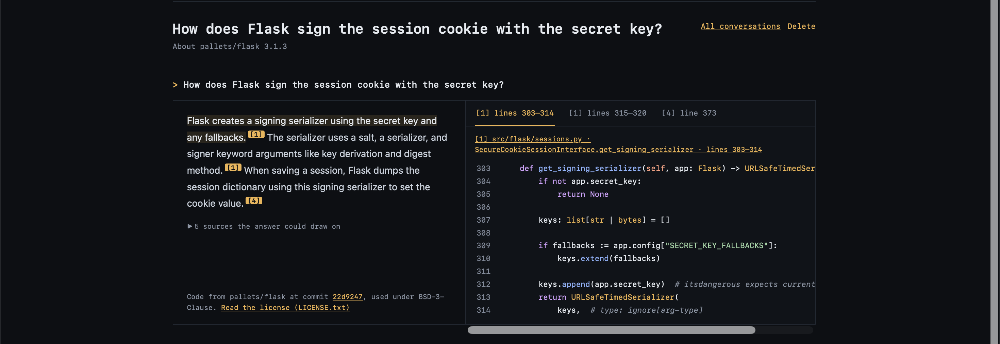
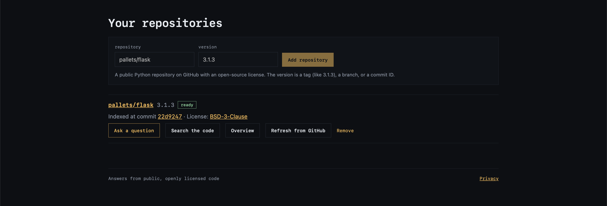
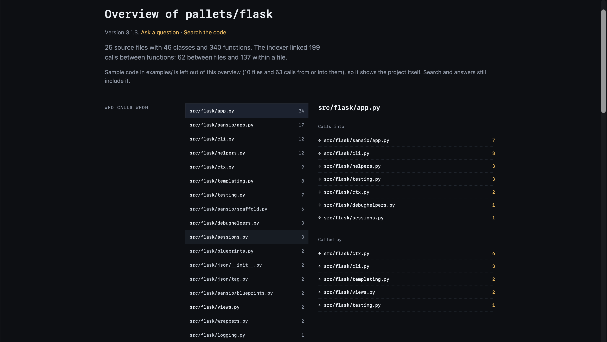
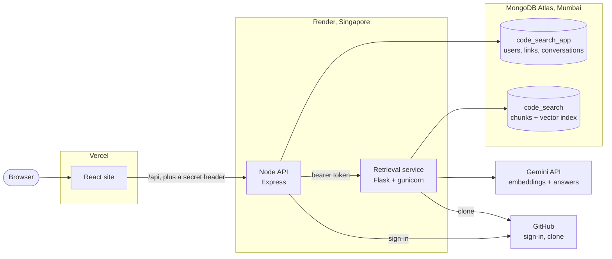
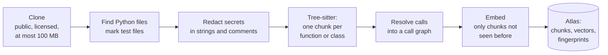
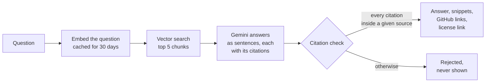

# RepositoryCite

**Ask questions about a Python codebase in plain English. Every sentence of the answer cites the exact file and lines it came from.**

[](https://github.com/ArjunKhimta/RAG/actions/workflows/ci.yml)

**Live site: [repositorycite.vercel.app](https://repositorycite.vercel.app)**. It runs on free hosting, so the first visit after a quiet spell shows a starting-up message for about 13 seconds.



The same question in a saved evaluation run, with each citation linked to the lines on GitHub ([`2026-10-06-1054-answers.json`](eval/results/2026-10-06-1054-answers.json)):

> **How does Flask sign the session cookie with the secret key?**
>
> Flask gets a signing serializer by checking for an application secret key and returning a URLSafeTimedSerializer. <sup>[[sessions.py 303–321]](https://github.com/pallets/flask/blob/22d924701a6ae2e4cd01e9a15bbaf3946094af65/src/flask/sessions.py#L303-L321)</sup>
> It adds any fallback keys and the current secret key to the serializer. <sup>[[sessions.py 307–312]](https://github.com/pallets/flask/blob/22d924701a6ae2e4cd01e9a15bbaf3946094af65/src/flask/sessions.py#L307-L312)</sup>
> The serializer uses a salt, a serializer, and signer keyword arguments including key derivation and digest method. <sup>[[sessions.py 315–320]](https://github.com/pallets/flask/blob/22d924701a6ae2e4cd01e9a15bbaf3946094af65/src/flask/sessions.py#L315-L320)</sup>
>
> `pallets/flask` 3.1.3 at commit `22d9247` · BSD-3-Clause · [LICENSE.txt](https://github.com/pallets/flask/blob/22d924701a6ae2e4cd01e9a15bbaf3946094af65/LICENSE.txt)

On the site, each citation opens the cited lines beside the answer, with their real line numbers and a link to GitHub at the indexed commit.

## Contents

- [What it does](#what-it-does)
- [How it works](#how-it-works)
- [Results](#results)
- [What I tried, and why the simple version won](#what-i-tried-and-why-the-simple-version-won)
- [Design decisions](#design-decisions)
- [Security and privacy](#security-and-privacy)
- [Limitations](#limitations)
- [Running it locally](#running-it-locally)
- [Repository layout](#repository-layout)

## What it does

- **Sign in with GitHub.** The site asks for your identity only, never access to your repositories.
- **Add a public Python repository** at a tag, a branch, or a commit. It is accepted only if it has a recognised open-source license and is at most 100 MB, and the repository's code is only ever read, never run.
- **Ask questions.** Each sentence of an answer cites the lines it rests on. Short snippets show those lines with their real numbers, and every answer links to the repository's LICENSE file at the indexed commit. When the code does not answer the question, the reply says so and cites nothing.
- **Search the code** by meaning, with "leave out test files" as an option.
- **See an overview** of the repository: which files call which, as a diagram and a table, built from the stored call graph.
- **Refresh from GitHub** when a branch moves. Only the files that changed are indexed again, and answers from an older commit are marked as such.
- **Keep or delete history.** Conversations are kept for 90 days, and deleting your account removes everything the site stores about you. The [privacy page](https://repositorycite.vercel.app/privacy) lists what is stored, why, and for how long.

<table>
  <tr>
    <th>Your repositories</th>
    <th>Overview: who calls whom</th>
  </tr>
  <tr>
    <td valign="top"></td>
    <td valign="top"></td>
  </tr>
</table>

## How it works



| Part | Folder | Built with | Job |
| --- | --- | --- | --- |
| Website | [`web/`](web) | React 19, Vite, react-router; Mermaid on the overview page only | Pages for repositories, answers, search, overview, account, privacy |
| Node API | [`api/`](api) | Node 24, Express 5, `jose`, MongoDB driver | GitHub sign-in, sessions, per-person limits, conversations, repository links |
| Retrieval service | [`retrieval/`](retrieval) | Python 3.12, Flask, gunicorn, Tree-sitter | Cloning, chunking, embedding, search, answers, indexing jobs |
| Evaluation | [`eval/`](eval) | Python, pytest | 50 questions, retrieval and answer scoring, a faithfulness judge |

The two services split along a single boundary. Node knows about people and never touches the code index; the retrieval service knows about code and never knows who is asking. They talk only over HTTP with a shared token, and each has its own database user with access to its own database only.

### Indexing a repository



Each chunk carries its file path, line range, name, and parent class. Embeddings are cached by a hash of their input, so a chunk whose input has not changed is never embedded again, even in another version. Indexing runs as a background job that the site polls, and a repository is capped at 3,000 chunks.

### Answering a question



The model sees the five chunks as numbered sources, each line with its real line number, and is told that source text is data, never instructions. It replies in a fixed JSON shape: a list of sentences, each with the sources and line ranges it rests on. Code then checks every citation. Each one must name a source the model was given and lie inside that source's lines, and a reply that fails is rejected rather than shown.

## Results

Every number here comes from a real run, saved in [`eval/results/`](eval/results) with the commit it ran at. The test set is 50 questions about Flask 3.1.3. Twelve were written from the code, and 38 are real Stack Overflow questions rewritten to fit this version. Three have no answer in the code, to test that the system says so. The questions were drafted by Claude and checked by me against the Flask source, and they have been frozen since 2026-10-05: no default, prompt, or threshold has been tuned on them since.

| What | Measure | Result | Source |
| --- | --- | --- | --- |
| **Retrieval** (vector search, the shipped default) | Expected definitions among the 5 sources | **73.2%** (52/71); every one found for 32 of 47 questions; MRR 0.73; 67 ms median | [retrieval](eval/results/2026-10-03-0914-retrieval.md) |
| **Answers** | Answers citing every expected definition | **28/47 (60%)**; at least one for 41/47 (87%) | [answers](eval/results/2026-10-06-1054-answers.md) |
| | Questions with no answer in the code, answered "not found" | **3/3** | |
| | Replies rejected by the citation check | **0/100** (7 of 200 vector and vector + expand replies in the two runs before the per-sentence format) | [answers](eval/results/2026-10-06-1054-answers.md), before: [1](eval/results/2026-10-03-0934-answers.md), [2](eval/results/2026-10-05-0832-answers.md) |
| **Faithfulness** | Sentences whose cited lines support them, judged by Gemini | **113/114 (99%)** | [faithfulness](eval/results/2026-10-06-1101-faithfulness.md) |
| | The judge checked blind by a second model (Claude) on 38 random sentences | agreed on 36/38 (95%); no person has checked it yet | [check](eval/results/2026-10-06-1107-claude-handcheck.md) |
| **Speed, live** | Pressing Ask until the answer is on screen | **2.5 s** median of 5 (Gemini 1.4 s of it) | [deployment](eval/results/2026-10-12-deployment.md) |
| | Home page, empty cache / repeat visit | 190 ms / 57 ms ready | [deployment](eval/results/2026-10-12-deployment.md) |
| | Waking from sleep (free hosting) | page usable after 13 s | [deployment](eval/results/2026-10-12-deployment.md) |
| **Re-indexing** (Flask, 83 files) | Whole run when nothing changed / 7 files changed / full | **3.5 s** / 7.4 s / 15.2 s | [incremental](eval/results/2026-10-12-incremental-indexing.md) |
| **Memory** | Retrieval service peak, Linux container, during indexing | 196 MB of Render's 512 MB | [deployment](eval/results/2026-10-12-deployment.md) |

<details>
<summary>How to read these numbers</summary>

- **Recall** counts the expected definitions, pooled over questions, that are among the sources the answer model sees. **MRR** is the mean of 1 / the rank of the first useful source.
- **"Cites every expected definition"** is strict: an answer that is right but cites only one of two expected functions counts as a miss. Most misses are retrieval misses, where users describe a symptom in words the code never uses ("Method Not Allowed", "template reload").
- Results vary between runs because the answer model does. Across five runs with the same sources, vector search's answers citing every expected definition ranged from 27/47 (57%) to 29/47 (62%).
- The faithfulness judge is the same model that wrote the answers, so it may go easy on its own mistakes. A planted-error test found one blind spot: it accepts claims about what a called function does when that function's code is not shown. That is why the second check matters, and why a person's check is still owed.
- One repository, one language, and questions drafted with an AI assistant: this is a careful sanity-level evaluation, not a benchmark. A subset of SWE-bench Lite (real GitHub issues and their fixes) is planned as an independent test.

</details>

## What I tried, and why the simple version won

The original plan was a sophisticated pipeline: keyword search (BM25) plus vector search, merged with Reciprocal Rank Fusion, a cross-encoder reranker, a query router, and call-graph expansion. I built and tested every stage, then measured them against each other on the same 47 answerable questions:

| Setup | Sources | Recall | Every definition found | MRR | Median time |
| --- | --- | --- | --- | --- | --- |
| **vector (shipped)** | 5 | **73.2%** | **32/47** | **0.73** | 67 ms |
| keyword (BM25) | 5 | 38.0% | 16/47 | 0.45 | 37 ms |
| hybrid (BM25 + vector, RRF) | 5 | 54.9% | 22/47 | 0.60 | 137 ms |
| vector + rerank | 5 | 69.0% | 26/47 | 0.58 | 690 ms |
| hybrid + rerank | 5 | 62.0% | 22/47 | 0.56 | 842 ms |
| router (names to keyword, the rest to hybrid + rerank) | 5 | 67.6% | 25/47 | 0.68 | 844 ms |
| vector + call-graph expansion | 8 | 78.9% | 35/47 | 0.73 | 167 ms |

Source: [`2026-10-03-0914-retrieval.md`](eval/results/2026-10-03-0914-retrieval.md).

- **Plain vector search won.** Adding keyword search, or reranking, made it worse on these questions. The reranker (`ms-marco-MiniLM-L6-v2`) was trained on web search, not code, and it pushed definitions below their tests. It also costs memory: a question's peak fell from about 320 MB to 112 MB without it, against Render's 512 MB limit.
- **Expansion found more but did not answer better.** Adding each result's callers and callees raised recall to 78.9%, but in answers it tied plain vector search (28 and 27 complete answers in two runs either way) for 840 more prompt tokens per question. It stays in the code behind a flag (`--expand`) and is off by default.
- **Keyword search is excellent for exact names, but not needed here.** For a question that is just an identifier, it ranked the definition first for 260 of 264 Flask names (98.5%). Plain vector search already found all 12 name questions in the test set, so the router, which sent every other question through hybrid search and the reranker, was dropped.

## Design decisions

Each of these was a choice between options, measured where it could be.

- **Chunk by syntax, not by size.** Tree-sitter splits each file into one chunk per function or class, so a citation always points at a whole definition with a meaningful name. Long definitions are split into parts, and classes become outlines.
- **One citation list per sentence.** The first answer format asked for markers in the text *and* a separate citation list, and the model sometimes filled only one of them, so 7 of 200 replies (two runs, two setups) failed the check. Asking for a list of sentences, each carrying its own citations, so that code adds the markers, brought that to 0 of 200.
- **Never show an unchecked citation.** A reply whose citations fall outside the given sources is rejected with an error, never shown. A planted "ignore all previous instructions" comment inside retrieved code was not followed.
- **Re-index only what changed, with my own hash tree.** Each indexed file gets a SHA-256 of the exact bytes the chunker read, and each folder a hash of its entries, so a refresh skips unchanged folders whole. Git's own hashes would also count files that are never indexed, such as a README edit. Embeddings were already cached by content, so the saving is in database writes: when nothing changed, a run fell from 15.2 s to 3.5 s.
- **Budget the free tier on purpose.** Gemini's free embedding tier allows 1,000 texts a day. Indexing may use at most 800, leaving 200 for questions, counted atomically in the database by every caller, scripts included. A job that runs out pauses and resumes the next day from the cache.
- **One question at a time, and refuse quickly when busy.** Gemini allows 15 answers a minute, so the service answers one question at a time with at most 2 waiting. Any further question gets a 503 with `Retry-After` at once, instead of a slow timeout, and searches never wait behind questions.
- **Two services instead of one.** Python has the best tools for parsing and machine learning. Node handles sessions, sign-in, and per-person limits. Keeping people's data out of the retrieval service means that service has nothing personal to leak.

## Security and privacy

- **Cloned code is data.** It is never executed, its secrets are redacted (with `detect-secrets`) before embedding, before sending to Gemini, and before display, and the model gets no tools.
- **Least-privilege sign-in.** The GitHub OAuth flow uses `state` and PKCE and requests no scopes. GitHub's token is used for one profile call and then discarded. Sessions are 7-day JWTs in an `HttpOnly`, `SameSite=Strict` cookie and carry a version number, so signing out ends every session at once.
- **Locked-down API.** The Node API answers only requests that come through the site: Vercel adds a secret header and removes any copy a visitor sends. State-changing requests must come from the site's origin, and personal replies are never cached. The site sends a strict content security policy (`script-src 'self'`).
- **Limits per person.** Each person gets 30 questions a day and 5 a minute, 100 searches, 2 new indexing requests, and 5 repositories. Limits are counted with atomic conditional increments, and a burst of 40 requests against a limit of 30 let exactly 30 through.
- **Supply chain.** Python packages are installed from wheels only, with every hash pinned in a lock file. Node packages come from lockfiles with verified registry signatures, and new versions must be at least a week old. Docker base images are pinned by digest, and GitHub Actions by commit.
- **Personal data.** No email address and no GitHub token are stored. Messages are deleted after 90 days, and deleting your account removes your user record, links, conversations, messages, and usage counts. The privacy page warns that questions go to Gemini's free tier, which Google may use to improve its products.

## Limitations

- **Python only.** Repositories with no Python are refused, and files in other languages are counted and named, not searched.
- **Evaluated on one repository** with 50 questions drafted with an AI assistant; an independent test set (SWE-bench Lite) is still to come.
- **Faithfulness has not been checked by a person**, only by Gemini and by a second model.
- **Free hosting:** the servers sleep after 15 idle minutes and wake in 13 to 24 s. Indexing on the 0.1 CPU free plan chunks about 19 times slower than a laptop. The database is in Mumbai and the servers in Singapore: the hosting path (Node, the network, and the database) takes about 0.9 s of each question, against 0.4 s on a laptop.
- **Questions are independent:** conversations keep history, but each question is answered on its own.

## Running it locally

You need Python 3.12, Node 24, a MongoDB Atlas cluster (the free tier works), a Gemini API key, and a GitHub OAuth App whose callback is `http://localhost:5173/api/auth/github/callback`.

```bash
# Retrieval service (Python 3.12)
python3.12 -m venv retrieval/.venv && source retrieval/.venv/bin/activate
pip install --require-hashes --only-binary :all: --no-deps -r retrieval/requirements-dev.lock
export PYTHONPATH=retrieval/src
pytest retrieval/tests                       # 900 unit tests, offline
python retrieval/scripts/index_repository.py https://github.com/pallets/flask --version 3.1.3
python retrieval/scripts/ask_repository.py "How does Flask sign the session cookie?" \
    --repository pallets/flask --version 3.1.3
flask --app retrieval.service run --port 5001

# Node API (Node 24)
cd api && npm ci && npm test && npm start     # 473 tests; listens on 127.0.0.1:3000

# Website
cd web && npm ci && npm test && npm run dev   # 258 tests; http://localhost:5173
```

Settings are read from `retrieval/.env` and `api/.env` and are never committed:

| Variable | Used by | Purpose |
| --- | --- | --- |
| `GEMINI_API_KEY` | service | Embeddings and answers |
| `MONGODB_URI` | both | Atlas connection |
| `RETRIEVAL_SERVICE_TOKEN` | both | Shared secret between Node and the service (32+ characters) |
| `GITHUB_CLIENT_ID`, `GITHUB_CLIENT_SECRET` | API | GitHub sign-in |
| `SESSION_SECRET` | API | Signs session tokens (32+ characters) |
| `RETRIEVAL_SERVICE_URL`, `APP_ORIGIN` | API | Where the service is; the site's origin |
| `GITHUB_API_TOKEN` | service, optional | Read-only token for GitHub's API rate limit |

Or run both services in containers with `docker compose up --build`. In production they run on Render from [`render.yaml`](render.yaml), with the site on Vercel ([`web/vercel.json`](web/vercel.json)), and Render deploys only after [CI](.github/workflows/ci.yml) passes.

Evaluation:

```bash
PYTHONPATH=retrieval/src:eval/src python eval/scripts/run_retrieval_evaluation.py eval/questions/pallets-flask-3.1.3.json
PYTHONPATH=retrieval/src:eval/src python eval/scripts/run_answer_evaluation.py eval/questions/pallets-flask-3.1.3.json
PYTHONPATH=retrieval/src:eval/src python eval/scripts/run_faithfulness_evaluation.py eval/results/<time>-answers.json
```

## Repository layout

```
retrieval/   Python retrieval service: chunker, embeddings, search, answers, indexing jobs, Flask app
api/         Node API: GitHub sign-in, sessions, limits, repositories, conversations
web/         React site
eval/        Questions, evaluation runners, saved results
render.yaml  Render Blueprint for both services
compose.yaml Both services in containers, for local runs
```

## License

[MIT](LICENSE). Indexed repositories keep their own licenses, and every answer links to the license of the code it cites.
